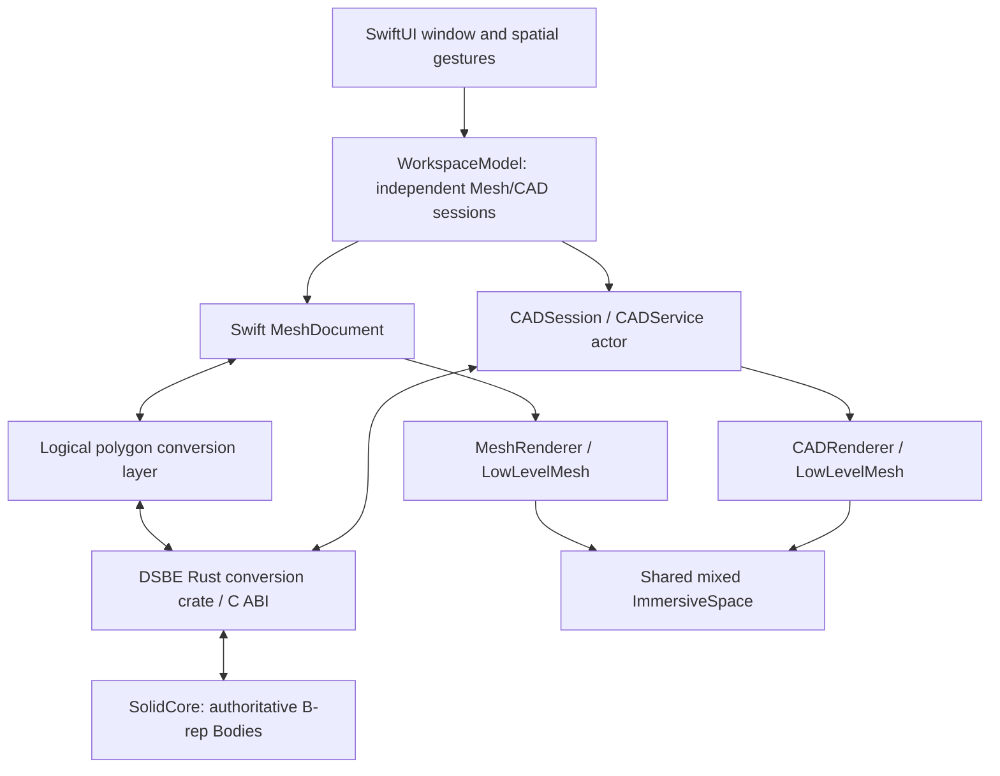

# Spatial Modeling

**Native hybrid Mesh and CAD modeling for Apple Vision Pro, powered by Swift, RealityKit, and Rust.**

Developed and maintained by **Design Studio Butterfly Effect (DSBE)**.

Planned repository: [Nippar-DSBE/Spatial-Modeling](https://github.com/Nippar-DSBE/Spatial-Modeling). 

## Overview

Spatial Modeling is an open-source spatial 3D modeler built natively for visionOS. It combines free polygon-mesh editing with on-device SolidCore CAD operations in one SwiftUI control window and one mixed ImmersiveSpace.

Version **v0.1.0** is an early prototype for simple polyhedra. Mesh Mode and CAD Mode keep independent shapes, selections, histories and display transforms. Switching modes preserves both sessions and does not automatically convert geometry.

## Demo


https://github.com/user-attachments/assets/19affeeb-1af6-4fb2-a602-575a23891cde


## Features

| | Mesh Mode | CAD Mode |
| --- | --- | --- |
| Authoritative shape | Swift logical polygon mesh | Rust / SolidCore B-rep Body |
| Direct editing | Vertex, Edge and Face free translation | Vertex/Edge hybrid editing; planar Face Push / Pull |
| Conversion | Convert to CAD | Convert to Mesh |
| CAD tools | — | Generate Box, fixed-tool Boolean Cut |
| Object tools | Move, rotate, uniform display scale | Same; CAD dimensions stay unchanged |
| History | Undo / Redo / Reset Shape | Undo / Redo / Reset Shape |

- Native SwiftUI / RealityKit / LowLevelMesh rendering, with actual B-rep element selection in CAD Mode.
- One-hand object movement and standard two-hand scale/rotation gestures, separate from element editing.
- Display Scale: 10–300% slider, 1–1000% numeric entry, 100% button and independent Reset Transform.
- Source-preserving explicit conversion, with confirmation before replacing an existing destination.
- One history entry per drag or scale-slider interaction; up to 100 Mesh actions and 32 CAD actions.
- Revision checks, stale-result rejection and rollback on invalid CAD reconstruction.
- All modeling works locally without a network connection.

## Architecture



Logical polygon topology, CAD topology and rendering triangles are separate. Display transforms belong to each session; they are not baked into CAD dimensions. A 300 mm box displayed at 200% remains a 300 mm CAD Body. Gesture displacement is converted into model-local coordinates before editing.

## Mesh / B-rep Hybrid Editing

CAD Vertex/Edge direct editing is an original DSBE integration of the existing Swift Mesh engine and Rust B-rep conversion:

1. Export the CAD Body's actual vertices, straight edges and face boundaries into a temporary logical MeshDocument.
2. While pinching, deform that document using the same Swift engine as Mesh Mode and update the lightweight LowLevelMesh preview.
3. On release, reconstruct and validate a formal SolidCore Body asynchronously.
4. Commit only on success; otherwise restore the starting CAD Body and its rendering. A preview-only deformation is never retained as a formal CAD edit.

Planar polygon faces are preserved. Only polygons made nonplanar by deformation are split into real planar CAD Faces. Display-tessellation diagonals are not automatically introduced as logical editable edges. Necessary reconstruction edges are real CAD edges.

Explicit **Convert to CAD** / **Convert to Mesh** actions preserve the source. Existing destinations require confirmation. Geometry and display pose replacement can be undone; normal mode switching does not convert anything.

Initial conversion/hybrid scope: **one closed planar solid with straight edges, one shell and one simple loop per face**. Curved geometry, face holes and internal cavities are not supported. The welding/planarity tolerance is **0.0001 mm**. Rust CAD arithmetic uses f64; Swift Mesh editing uses Float, so general round trips are not exact. See [Hybrid modeling](Docs/HYBRID_MODELING.md).

## On-device CAD Computing

SolidCore runs inside the application through a thin C ABI and a local Rust worker. It owns the authoritative B-rep Bodies, executes Boolean Difference and planar face offsets, validates reconstructed shapes, and tessellates results for RealityKit. No external PC, server, WebView, MCP or network service is required at runtime.

Swift handles gestures, selection, temporary mesh previews and UI/history coordination. CAD work runs off the MainActor. Per-stage timing and memory measurements are available for device evaluation; performance is not guaranteed.

## Requirements

- Apple silicon development Mac; Xcode **27.0 (27A266a)** with the **visionOS 27.0 SDK**.
- Apple Vision Pro for final interaction testing and deployment.
- Rust **1.99.1** and **aarch64-apple-visionos** target; Python 3 for scripts.
- Several GB of free build storage. Scripts never install Rust, SDKs or Simulator runtimes automatically.

Only physical-device visionOS builds are supported. No Simulator slice or Runtime is required.

## Build Instructions

This is a source-only project. Rebuild the ignored native XCFramework before building the app.

1. Install/select Xcode and the Rust toolchain explicitly if needed:

   ```sh
   rustup toolchain install 1.99.1 --profile minimal
   rustup target add aarch64-apple-visionos --toolchain 1.99.1
   ```

2. Fetch locked dependencies once. This setup step needs network access:

   ```sh
   cargo +1.99.1 fetch --locked --manifest-path Native/SolidCore/Cargo.toml
   ```

3. Build the device library and unsigned app:

   ```sh
   zsh Scripts/rebuild-solidcore-device.sh
   zsh Scripts/build-device.sh
   ```

   The native build uses `--locked --offline`, vendored SolidCore, and the selected Xcode xros SDK. Generated libraries and caches are ignored. See [Build notes](Docs/BUILDING.md) for environment overrides and reproducibility limits.

4. Open `Spatial Modeling.xcodeproj`, choose your Vision Pro and set your own unique bundle identifier. Put `SPATIAL_DEVELOPMENT_TEAM = YOUR_TEAM_ID` in ignored `Config/Signing.local.xcconfig`, then Run. The unsigned script verifies compilation/linking only; it does not install or launch the app.

### Controls

1. Open ImmersiveSpace and choose Mesh Mode or CAD Mode, then Object / Vertex / Edge / Face.
2. Object: pinch the body or its white lower handle to move; use two hands to scale/rotate. Reset Transform restores placement, rotation and 100% display scale.
3. Mesh: gaze at a handle, pinch-drag and release to commit.
4. CAD Vertex/Edge: pinch-drag to preview, release to reconstruct the Body. CAD Face: push/pull the handle along its normal; the signed displacement is shown in mm.
5. Use the explicit conversion button to copy into the other session. Confirm replacement when prompted. Undo / Redo follow chronological shape and Object actions in the active session.
6. Boolean Cut uses a fixed smaller box. Reset Shape resets geometry independently of Reset Transform; an imported Mesh resets to its import baseline.

### Tests and audits

```sh
zsh Scripts/check-mesh-core.sh
zsh Scripts/check-mode-integration.sh
zsh Scripts/check-cad-direct.sh
zsh Scripts/check-object-transform.sh
zsh Scripts/check-hybrid-conversion.sh
python3 Scripts/audit-licenses.py
```

Host integration tests use actual Rust CAD operations and macOS RealityKit. They do not establish visionOS gesture quality. See the [Vision Pro checklist](Docs/DEVICE_TESTING.md). The local candidate audit is `python3 Scripts/audit-release.py` after explicitly preparing a candidate; internal audit reports and staging are excluded from publication.

## Current Limitations

- Early, session-only prototype: one object per mode, no persistent project save or file import/export. **STL export is not included in v0.1.0.**
- Hybrid editing/conversion is experimental and limited to simple closed planar solids: 4–256 input vertices, 4–512 faces, at most 128 corners per face. Curves, face holes, internal cavities and dense generated/imported meshes are unsupported.
- Large deformations, self-intersections, degeneracies, near contact, unsupported topology or kernel refusals reject the operation and preserve the previous formal Body. Reconstructed topology and subentity IDs can change.
- CAD Face Push / Pull currently uses planar normal offsets, tested with the generated box, its fixed cut and selected reconstructed polyhedra. Extrude, Fillet, Chamfer, Shell and numeric CAD dimension editing are not exposed.
- CAD face previews coalesce requests with a 30 Hz ceiling. Vertex/Edge previews are lightweight Mesh updates with reconstruction on release. Hardware latency, hand tracking and two-hand behavior require device testing; no frame-rate guarantee is made.
- Object picking uses a bounding-box collision proxy, including empty space within a cutout. Display Scale is not a CAD Scale Body operation.
- Histories are in memory. Display poses survive mode/space switching within a session, but no persistent world anchor or collaboration is implemented.
- Upstream binary fixtures/images are omitted from this source package. App/bridge tests and library builds are supported; full upstream fixture suites need the original upstream checkout.

## Roadmap

Planned, not implemented:

- GLB Import / Export
- Dynamic Mesh Topology
- Tripo API Integration
- Advanced CAD Direct Modeling
- Extrude / Fillet / Chamfer / Shell
- Volumetric Workspace
- SharePlay Collaborative Modeling
- Voice-controlled AI Modeling Assistant

Screenshots and demo videos can be added under [Docs/Media](Docs/Media/README.md) after review. No third-party branding or UI assets are bundled.

## License

Original Swift application, scripts, tests, documentation and the DSBE Rust `spatial-mesh-cad` conversion crate: **[MIT](LICENSE)**.

Copyright (c) 2026 Design Studio Butterfly Effect

The existing Rust bridge remains **Apache-2.0**. SolidCore and all other third-party code retain their own licenses, copyright and NOTICE files; they are not relicensed under MIT. See [License scope](Docs/LICENSING.md) and [THIRD_PARTY_NOTICES.md](THIRD_PARTY_NOTICES.md).

## Acknowledgements

- [SolidCore](https://github.com/tangency-labs/solidcore), pinned to [`d856327183691d55941b3abe3fb184583bfb6975`](https://github.com/tangency-labs/solidcore/tree/d856327183691d55941b3abe3fb184583bfb6975): `solidcore`, `solidcore-record`, `solidcore-convert`, `solidcore-ops` and `solidcore-tess`, Apache-2.0.
- [SolidCraft](https://github.com/tangency-labs/solidcraft), the related upstream project. Its application UI, renderer, themes, logos and branding are not included.
- SolidCore's SMLib / SM_API kernel derives from [NVIDIA USD BRep](https://github.com/NVIDIA-Omniverse/usd-brep), v1.0.1 / `3fd5b95`. Original notices and per-file provenance are preserved.
- [Rust](https://github.com/rust-lang/rust) 1.99.1 standard-library notices are preserved in `Licenses/Rust-1.99.1/` and bundled with the application.
- All **33** locked third-party packages and original license texts are listed in [THIRD_PARTY_NOTICES.md](THIRD_PARTY_NOTICES.md). The lockfile contains 35 packages including the two local crates.

Apple platform/framework names identify the target environment; no endorsement is implied.
